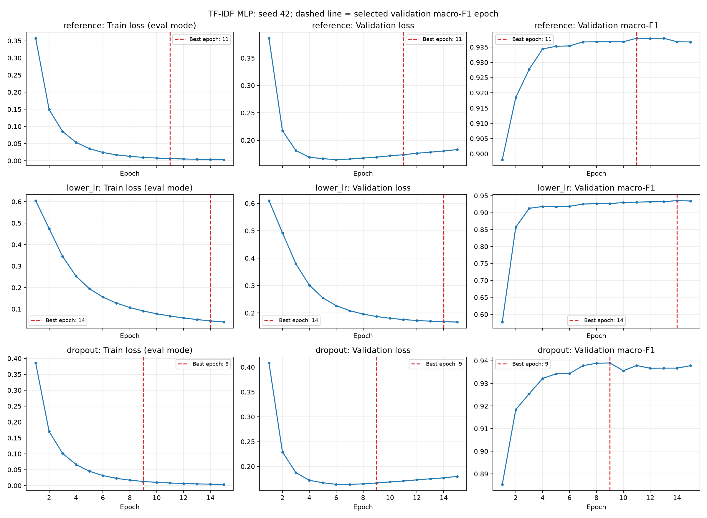

# Thí nghiệm PyTorch MLP — 06/11/2026

Đã hoàn thành 18/18 mục. MLP dropout 0,3 tốt nhất ở epoch 9: validation macro-F1 **0,939045**, accuracy **0,942589**. ComplementNB trên cùng TF-IDF đạt macro-F1 **0,923094**. Chênh lệch là **+1,595 điểm phần trăm macro-F1** trên validation, chưa phải kết quả test hay bằng chứng tổng quát về ưu thế của MLP.

Run: [`models/mlp/mlp_20261106_01/`](../models/mlp/mlp_20261106_01/). Thư mục model bị Git ignore; cần giữ toàn bộ bundle để chạy lại inference. Báo cáo và [biểu đồ](mlp_20261106_learning_curves.png) được lưu trong `docs/` để có thể theo dõi bằng Git.

## Dữ liệu và thiết kế đối chứng

Đọc nguyên trạng `train_split.csv` và `validation_split.csv` từ `models/evaluation_workflow/full_validation_20260929_01/`. Không chia lại dữ liệu, không augmentation, không đọc `test_split.csv`. Chỉ dùng cột **`clean_text`** làm đặc trưng; không dùng rating, review thô, ID hay nhãn trong đầu vào mạng. Đây là biểu diễn của cấu hình cũ `no_stopwords`: đã tách từ, không lọc stopword. Từ “reference” trong báo cáo này chỉ MLP learning rate 0,001/dropout 0, không chỉ cấu hình tiền xử lý reference cũ có lọc stopword.

| Tập | Negative → 0 | Positive → 1 | Tổng |
|---|---:|---:|---:|
| Train | 4.754 | 2.906 | 7.660 |
| Validation | 595 | 363 | 958 |

Không trùng `source_id` giữa hai tập; mỗi tập có source ID duy nhất và không có dòng augmentation. Các kiểm tra giao văn bản sạch và văn bản chuẩn hóa cũng đạt. Không có `clean_text` rỗng. Các kiểm tra này không chứng minh độc lập theo người viết, sản phẩm hoặc thời gian.

Fingerprint SHA-256 của đúng hai file đã đọc:

```text
train_split.csv       5a4e1a492f32d532090e462bb36db3373c22b8c078b324fb8aa8cdd0b400fcc6
validation_split.csv  ff1f197113875c8a57483648d21d1e66b00a8195f78de3b27b92762ce06526c9
```

TF-IDF dùng word unigram/bigram, `min_df=2`, `max_features=150000`, `sublinear_tf=True`, `lowercase=False`, L2 normalization, smoothed IDF, token pattern `(?u)\b\w+\b`. Chỉ gọi `fit_transform()` trên train, sau đó `transform()` trên validation. Vocabulary thực tế **24.982** đặc trưng. Cả bốn mô hình nhận cùng ma trận **float32**; đây là khác biệt kiểu số so với run cũ float64, không phải khác biệt đặc trưng giữa các đối chứng hiện tại. Điểm ComplementNB tái lập trùng điểm validation cũ đến các chữ số báo cáo.

## Dataset, kiến trúc và huấn luyện

Mã nguồn: [`src/mlp.py`](../src/mlp.py), [`src/run_mlp.py`](../src/run_mlp.py). `TfidfDataset` giữ CSR thưa và chỉ chuyển từng mẫu/batch sang dense, tránh tạo toàn bộ ma trận dense train. Batch thực đã kiểm tra:

```text
features: torch.float32 [128, 24982]
labels:   torch.int64   [128]       # torch.long
Linear → ReLU:         [128, 64]
Dropout → Linear:      [128, 2]     # logits, chưa softmax
```

Mạng gồm `Linear(V,64) → ReLU → Dropout(p) → Linear(64,2)`. CrossEntropyLoss nhận logits và nhãn long, không đặt softmax trước loss. Adam, batch size 128, weight decay 0, loss không trọng số, CPU 4 threads, seed **42** cho Python/NumPy/PyTorch và generator DataLoader. Bật deterministic algorithms. Khởi tạo lại seed trước mỗi cấu hình để có cùng trọng số ban đầu và thứ tự batch; khác biệt thêm randomness do dropout là một phần của cấu hình đó.

Vòng train có đầy đủ `train()`, `zero_grad()`, forward, loss, `backward()` và `step()`. Đánh giá dùng `eval()` và `torch.no_grad()`, trả loss trung bình theo mẫu, accuracy, macro-F1 và dự đoán. Loss trên biểu đồ được tính lại trên toàn tập ở cuối epoch trong eval mode: train và validation cùng tắt dropout, nên so sánh được. Loss trong lúc cập nhật được lưu riêng là `optimization_loss`.

Mỗi cấu hình chạy đủ **15 epoch**. Giữ bản sao trọng số tại macro-F1 validation cao nhất; nếu hòa thì lấy epoch sớm nhất. Chọn MLP cuối cùng bằng cùng chỉ số, hòa giữa cấu hình thì theo thứ tự khai báo. Không refit trên validation. Mỗi checkpoint đều được nạp lại và kiểm tra dự đoán/metrics trùng trước khi lưu báo cáo.

### Kiểm tra ghi nhớ 32 mẫu

Lấy ngẫu nhiên 16 mẫu mỗi nhãn từ train, seed 42; LR 0,001, dropout 0, một batch 32. Loss **0,696714 → 0,048904** sau **83 epoch**, accuracy **0,5 → 1,0**. Đạt tiêu chí accuracy 100% và loss cuối dưới 20% loss đầu. Đây là kiểm tra vòng học có thể tối ưu và ghi nhớ, không đánh giá tổng quát hóa. Giới hạn 15 epoch áp dụng cho ba thí nghiệm đầy đủ, không áp dụng cho phép thử chẩn đoán này. Chỉ số, index mẫu và lịch sử nằm ở [`overfit_32.json`](../models/mlp/mlp_20261106_01/overfit_32.json).

## Bảng so sánh validation

| Mô hình | Seed | LR | Dropout | Epoch tốt nhất / đã chạy | Validation loss | Accuracy | Macro-F1 |
|---|---:|---:|---:|---:|---:|---:|---:|
| ComplementNB, alpha=0,5 | 42* | — | — | — | — | 0,926931 | 0,923094 |
| MLP reference | 42 | 0,001 | 0 | 11 / 15 | 0,173577 | 0,941545 | 0,937903 |
| MLP lower_lr | 42 | 0,0003 | 0 | 14 / 15 | 0,168019 | 0,939457 | 0,935546 |
| **MLP dropout** | **42** | **0,001** | **0,3** | **9 / 15** | **0,166717** | **0,942589** | **0,939045** |

*ComplementNB không dùng RNG; 42 là seed của protocol/split. Không báo loss NB vì không dùng CrossEntropyLoss trong huấn luyện đối chứng. CSV/JSON đầy đủ: [`comparison.csv`](../models/mlp/mlp_20261106_01/comparison.csv), [`comparison.json`](../models/mlp/mlp_20261106_01/comparison.json).

NB sai **70** mẫu, MLP dropout sai **55**: giảm ròng 15 lỗi, tăng accuracy **1,566 điểm phần trăm**. Điều này không có nghĩa MLP chỉ sửa lỗi NB; nó cũng tạo ra lỗi mới (xem ví dụ 3, 4, 10, 12 bên dưới).

Thời gian fit NB trên TF-IDF đã có là khoảng 0,006 giây; ba vòng MLP mất khoảng 75,05 / 49,55 / 57,75 giây. Thời gian MLP gồm cả đánh giá train/validation sau mỗi epoch, NB không có các lần đánh giá đó; có tải máy và warm-up khác nhau, không dùng các số này để kết luận cấu hình LR/dropout nhanh hơn nhau. Không phải benchmark end-to-end hay inference production.

## Đường học



Đường đỏ đánh dấu epoch được chọn bằng macro-F1; các ô dùng thang dọc riêng. Với reference, validation loss nhỏ nhất ở epoch 6 (**0,164504**) nhưng macro-F1 tốt nhất ở epoch 11 (**0,937903**). Đến epoch 15, train loss chỉ còn **0,002980**, còn validation loss tăng lên **0,182925**. Cross-entropy đo cả độ tự tin; macro-F1 chỉ dựa vào nhãn argmax. Vì vậy hai tiêu chí không nhất thiết chọn cùng epoch, và loss tăng không tự động đồng nghĩa macro-F1 giảm ngay.

Lower LR học chậm: macro-F1 epoch đầu **0,577315**, so với **0,898078** của reference; đến epoch 15 validation loss vẫn giảm còn **0,166963**. Chưa có thí nghiệm dài hơn nên không kết luận learning rate thấp kém hơn khi đã hội tụ.

Dropout làm train loss epoch đầu cao hơn (**0,3859** so với **0,3574**), nhưng đạt validation macro-F1 tốt nhất **0,939045** ở epoch 9. Validation loss đạt đáy ở epoch 7 khoảng **0,1639**, sau đó tăng tới **0,1800** ở epoch 15: dropout không loại bỏ hoàn toàn overfit. Cải thiện macro-F1 so với reference chỉ **0,114 điểm phần trăm**, tương ứng giảm một lỗi validation; chưa có lặp seed hay kiểm định để khẳng định độ ổn định.

## Đánh giá từng lớp — MLP dropout, epoch 9

| Lớp | Precision | Recall | F1 | Support |
|---|---:|---:|---:|---:|
| negative | 0,954545 | 0,952941 | 0,953743 | 595 |
| positive | 0,923077 | 0,925620 | 0,924347 | 363 |
| Macro avg | 0,938811 | 0,939281 | 0,939045 | 958 |
| Weighted avg | 0,942622 | 0,942589 | 0,942604 | 958 |

Accuracy: **0,942589**. Confusion matrix: hàng là nhãn thật, cột là dự đoán.

| Thật / dự đoán | negative | positive |
|---|---:|---:|
| negative | 567 | 28 |
| positive | 27 | 336 |

Positive vẫn có precision/F1 thấp hơn negative. Số lỗi hai chiều gần nhau, nhưng positive có ít mẫu hơn. Toàn bộ dự đoán nằm trong [`validation_predictions.csv`](../models/mlp/mlp_20261106_01/validation_predictions.csv); classification report và ma trận cũng có bản JSON trong cùng thư mục.

## Đọc và phân tích 12 lỗi validation

Đã đọc đủ văn bản của 12 lỗi thật, lấy seed 42, mỗi chiều 6 trong tổng 28 negative→positive và 27 positive→negative. Đây là mẫu cân bằng có chủ đích, không đại diện tỷ lệ nguyên nhân của toàn bộ validation. Nhãn “thật” dưới đây là nhãn dataset, chưa được con người phân xử lại. Nhận xét do trợ lý thực hiện; diễn giải nội dung và giả thuyết về lỗi không phải giải thích nhân quả đã kiểm chứng của mạng.

CSV có đầy đủ `source_id`, `review`, `clean_text`, nhãn thật, dự đoán MLP và NB: [`error_review_12.csv`](../models/mlp/mlp_20261106_01/error_review_12.csv). Mã rút gọn dưới đây là 12 ký tự đầu sau `sha256:` để đối chiếu.

1. **`c4b15b0f792a` — thật negative; MLP positive; NB positive.** Văn bản: “Đúng với mô tả:khá Chất liệu:K bt Màu sắc:be  Mũ hơi ngắn.  K chỉnh đc .Ship thân thiện”. Có khen mô tả/ship nhưng phàn nàn mũ ngắn, không chỉnh được. Viết tắt “K chỉnh đc” mang phủ định. Đầu ra bỏ lỡ đánh giá tổng thể tiêu cực trong câu nhiều khía cạnh; chưa đo được trọng số đóng góp từng cụm.

2. **`ebc4f5feadbd` — thật negative; MLP positive; NB positive.** Văn bản: “Dùng như bth, tóc t vẫn ch thấy cải thiện ấy, k biết s nữa, blind box đẹp”. Tác dụng lên tóc chưa cải thiện, dù phụ kiện đẹp. “ch”/“k” là dạng rút gọn và lời khen nằm ở khía cạnh phụ. Cần hiểu mục tiêu sử dụng chính và phủ định, vượt quá việc cộng các dấu hiệu khen/chê độc lập.

3. **`fc3e1a942071` — thật negative; MLP positive; NB negative.** Văn bản: “Đã nhận hàng. Đóng gói cẩn thận. Giao sai hàng nha, đơn đặt là Matte-Kiềm dầu nhưng giao hàng là Hydrare. Đổi trả phiền phức nên nhận luôn. Ship chú ý nhé. Giá cả phù hợp, chất lượng thì để xem sao. Nếu sài OK sẽ quay lại mua tiếp.” Giao sai và đổi trả phiền là phản hồi tiêu cực rõ, xen kẽ lời khen đóng gói/giá và lời hứa có điều kiện. NB đúng còn MLP sai, cho thấy cải thiện điểm chung không bảo đảm xử lý tốt mọi câu tương phản hoặc điều kiện.

4. **`e3562f228c54` — thật negative; MLP positive; NB negative.** Văn bản: “Giao hàng nhanh, đóng gói cẩn thận, miếng dán lệch so với khung nên dán kiếng ko dc ở giữa điẹn thoại”. Phần đầu khen vận chuyển, phần sau chê sản phẩm không dùng đúng vị trí. Có phủ định viết tắt và lỗi chính tả. MLP không phản ánh được vấn đề chức năng chính, dù NB nhận đúng trên cùng TF-IDF.

5. **`28ee2ff630de` — thật negative; MLP positive; NB positive.** Văn bản: “Âm thanh:nghe chống điếc Thiết kế:ok”. “Nghe chống điếc” có thể là cách nói chê âm thanh chỉ dùng tạm, còn “ok” khen thiết kế. Câu rất ngắn, có sắc thái khẩu ngữ khó phân giải; diễn giải này cần người hiểu ngữ cảnh xác nhận, không tự động coi nhãn là sai.

6. **`3c93df500ff9` — thật negative; MLP positive; NB positive.** Văn bản: “Giao hàng nhanh Đóng gói ônd Chất kem lỏng Trơn ko thấm nhanh lấm Dưỡng vừa phải thôi Nếu ở phòng đh thì sẽ khô”. Khen giao hàng nhưng chê kem lỏng, thấm chưa nhanh và dưỡng hạn chế. Có từ gõ sai và viết tắt; chữ “nhanh” còn xuất hiện trong cả giao hàng lẫn phủ định thấm nhanh. Cần gắn cảm xúc với từng khía cạnh và phạm vi phủ định.

7. **`aee0855b9ab0` — thật positive; MLP negative; NB negative.** Văn bản: “Cũng mới sài loại này nên đánh giá ban đầu của t là serum hơi lỏng, thoa lên tóc ko có cảm giác bết dính, đc cái thơm.” “Ko có cảm giác bết dính” là lời khen qua phủ định một thuộc tính xấu, cộng với thơm; “hơi lỏng” là nhận xét dè dặt. Hai mô hình đều chưa phản ánh đúng cấu trúc phủ định và đánh giá tổng hợp.

8. **`23f7d37f88d4` — thật positive; MLP negative; NB negative.** Văn bản: “Đã nhận hàng thank shop, mua hàng của shop lần 2 rồi nc cảm giác mỏng như nhân trần… lần này mua loại này trải nghiệm xem sao”. Cảm ơn và mua lại hỗ trợ nhãn positive, còn trải nghiệm chưa được kết luận. Từ “mỏng” có thể khen hoặc chê tùy sản phẩm. Thiếu ngữ cảnh sản phẩm khiến ý nghĩa tổng thể không hoàn toàn rõ; không đủ căn cứ kết luận lỗi annotation.

9. **`216cc82eea30` — thật positive; MLP negative; NB negative.** Văn bản: “Đóng gói ổn hơn mọi lần. Hộp vuông vắn ko bị móp méo. Mua hãng sữa này nhiều rồi mà mãi không thấy sale hic”. “Ko bị móp méo” khen tình trạng hàng, nhưng đoạn cuối than chưa sale. Đây là phủ định thuộc tính xấu và cảm xúc pha trộn giữa chất lượng đóng gói với khuyến mại.

10. **`72395287ab4a` — thật positive; MLP negative; NB positive.** Văn bản: “Tôi rất hài lòng với dịch vụ và chất lượng các bạn mang tới 💚💚💚💚 Chúc các bạn buôn may bán đắt 😘😘😘”. Cảm xúc tích cực rõ; `clean_text` vẫn giữ “rất hài_lòng” và lời chúc sau khi bỏ emoji. Đây là lỗi MLP thật trên câu khen rõ mà NB đúng. Chưa có attribution để khẳng định nguyên nhân; không nên quy ngay cho từ “đắt”, thiếu dữ liệu hay emoji bị bỏ.

11. **`f52ca4b7e3de` — thật positive; MLP negative; NB negative.** Văn bản: “mua 1 lần mà dính tới giờ, dùng sướng lắm mọi người ơiiiii, nên mua nkaaaa”. Có lời khen “dùng sướng” và khuyến nghị mua; “dính tới giờ” mang nghĩa thích/tiếp tục dùng trong ngữ cảnh này. Slang và kéo dài chữ làm bề mặt từ vựng biến đổi. Chưa đo được mô hình đang phản ứng với cụm nào, nên chỉ coi đây là ví dụ cần đánh giá khả năng hiểu khẩu ngữ.

12. **`fb8e8c9e2c07` — thật positive; MLP negative; NB positive.** Văn bản: “Công dụng:vừa nhận chưa mà thấy đẹp phải đợi trải nghiệm rồi quay lại đánh giá  Thấy trên shark tank mua dùng ủng hộ”. Có thiện cảm về ngoại hình và ý định ủng hộ, nhưng chưa có trải nghiệm công dụng. Phân biệt thiếu bằng chứng sử dụng với phản hồi tiêu cực là cần thiết; MLP sai còn NB đúng.

Các ví dụ gợi ý ưu tiên nghiên cứu về phủ định viết tắt, phản hồi nhiều khía cạnh và khẩu ngữ. MLP vẫn nhận đầu vào bag-of-ngrams như NB: hidden layer có thể học tổ hợp phi tuyến nhưng không khôi phục đầy đủ thứ tự câu, chủ thể hay phạm vi phủ định. Không sửa nhãn hay huấn luyện thêm dựa trên 12 lỗi này trong run đã báo cáo.

## Checklist đã hoàn thành

| Hoàn thành | Công việc | Bằng chứng |
|---|---|---|
| ☑ | Đọc train/validation đã lưu | 7.660/958, source overlap 0; `data_audit.json` |
| ☑ | Kiểm tra văn bản và nhãn | `clean_text`; negative=0, positive=1; hai lớp đủ ở mỗi tập |
| ☑ | Tạo TF-IDF | Fit train; transform validation; vocabulary 24.982; test token chỉ có ở validation bị loại |
| ☑ | Chạy ComplementNB | Alpha 0,5, cùng đặc trưng; macro-F1 0,923094 |
| ☑ | TfidfDataset/DataLoader | CSR → batch dense; float32/long; batch thực đã kiểm tra |
| ☑ | MLP một hidden layer | `[128,24982] → [128,64] → [128,2]` |
| ☑ | Hàm huấn luyện | `train_epoch()` đủ zero_grad/forward/loss/backward/step |
| ☑ | Hàm đánh giá | `evaluate()` có eval/no_grad; loss, accuracy, macro-F1 |
| ☑ | Ghi nhớ 32 mẫu hai nhãn | 16+16; loss 0,6967 → 0,0489; accuracy 100% |
| ☑ | MLP reference | LR 0,001, dropout 0, đủ 15 epoch |
| ☑ | Giảm learning rate | LR 0,0003; các thiết lập còn lại giữ nguyên |
| ☑ | Thử dropout | Dropout 0,3, LR 0,001; các thiết lập còn lại giữ nguyên |
| ☑ | Giữ checkpoint tốt nhất | Ba file `*_best.pt`; kiểm tra save/load trùng dự đoán |
| ☑ | Vẽ đường học | PNG có ba đại lượng cho đủ ba cấu hình; CSV lịch sử 15 epoch |
| ☑ | Bảng so sánh | Bốn mô hình, seed/cấu hình/epoch/metrics; CSV/JSON |
| ☑ | Đánh giá từng lớp | Classification report và confusion matrix MLP dropout |
| ☑ | Phân tích 10–15 lỗi | Đọc và nhận xét 12 lỗi thật bên trên; CSV nguồn đi kèm |
| ☑ | Kết luận khoảng nửa trang | Phần tiếp theo |

## Kết luận

Trên split validation cố định của project, MLP một hidden layer 64 nút đã học được từ TF-IDF và vượt ComplementNB trong cả ba cấu hình. MLP dropout 0,3 được chọn tại epoch 9, đạt macro-F1 0,9390 và accuracy 0,9426; NB lần lượt đạt 0,9231 và 0,9269. Kết quả phù hợp với khả năng hidden layer kết hợp các đặc trưng từ/ngram linh hoạt hơn, nhưng phép so sánh này chưa xác định cơ chế gây cải thiện. NB vẫn là đối chứng mạnh, huấn luyện nhẹ và đúng ở một số câu MLP sai. Thử ghi nhớ 32 mẫu đạt 100% giúp xác nhận vòng học và ánh xạ nhãn hoạt động, không chứng minh chất lượng trên dữ liệu mới.

Giảm learning rate từ 0,001 xuống 0,0003 làm quá trình học chậm hơn trong cùng ngân sách 15 epoch: epoch tốt nhất chuyển từ 11 sang 14 và macro-F1 giảm từ 0,9379 xuống 0,9355. Validation loss của cấu hình LR thấp vẫn giảm ở cuối run, nên chưa thể coi LR thấp là lựa chọn kém khi cho thêm thời gian hội tụ. Dropout 0,3 đem lại điểm cao nhất nhưng chỉ hơn reference khoảng 0,00114 macro-F1, tương ứng một lỗi ít hơn. Đây là cải thiện nhỏ của một seed, chưa đủ bằng chứng cho lợi ích ổn định của dropout.

Đường học cho thấy train loss tiếp tục giảm trong khi validation loss của reference và dropout tăng về cuối. Giữ checkpoint theo validation macro-F1 giúp tránh mặc định lấy epoch cuối; tuy vậy loss và F1 tối ưu ở các epoch khác nhau vì đo các thuộc tính khác nhau. Phân tích lỗi vẫn gặp phủ định viết tắt, khen/chê nhiều khía cạnh, khẩu ngữ và cả câu khen rõ. MLP trên bag-of-ngrams chưa giải quyết đầy đủ các vấn đề ngữ nghĩa đó. Validation đã dùng để chọn 45 checkpoint và đọc lỗi, nên các điểm trên có thể lạc quan do lựa chọn. Bước nghiên cứu tiếp theo hợp lý là lặp nhiều seed và đánh giá một protocol/dữ liệu mới được chốt trước; test lịch sử của project đã từng được đọc lỗi nên không gọi đó là holdout mới. Run này giữ nguyên dữ liệu và không đọc test.

## Kiểm chứng, artifact và cách chạy

Đã chạy **65 tests, OK** (61 test cũ + 4 test MLP mới), gồm fit-vocabulary chỉ trên train, chặn source overlap/nhãn lạ, dtype/batch, eval tắt dropout và gradient, checkpoint epoch tốt nhất thay vì epoch cuối. Nạp checkpoint trong **tiến trình Python mới** và dự đoán lại đủ **958** `clean_text` cho nhãn trùng hoàn toàn CSV, xác suất cộng về 1. Các xác suất softmax chưa được hiệu chỉnh. Biểu đồ đã được mở kiểm tra trực quan.

Môi trường chạy thực: Windows, Python **3.13.5**, PyTorch **2.15.0+cpu**, matplotlib **3.11.0**. Phiên bản còn lại, mã nguồn hash và input hash nằm trong `metadata.json`; danh sách package trong `requirements-resolved.txt`. Giữ cả source và bundle, không chỉ file `.pt`. Cấu hình `.venv` hiện trỏ Python 3.13 ở máy tác giả, cần interpreter tương ứng hoặc dựng virtualenv mới khi chuyển máy.

```powershell
# Từ thư mục gốc; cần có bundle split nguồn tại đường dẫn mặc định.
.venv/Scripts/python.exe -u -m src.run_mlp --run-name mlp_reproduction_01
.venv/Scripts/python.exe -m unittest discover -s tests -v

# API này nhận clean_text đã tiền xử lý; không truyền review thô.
.venv/Scripts/python.exe -m src.mlp --run-dir models/mlp/mlp_20261106_01 --clean-text "sản_phẩm không tốt" "giao_hàng nhanh chất_lượng tốt"
```

`src.run_mlp --help` có tùy chọn split/output directory, seed, threads và batch size. Số mẫu 7.660/958 và ba cấu hình/15 epoch được cố định để đúng protocol; `load_splits()` từ chối dữ liệu khác số lượng thay vì âm thầm làm thí nghiệm khác. Chọn run name mới mỗi lần, không ghi đè run cũ. Mỗi lần rerun sinh lại dữ liệu đo/plot và mẫu lỗi; phần nhận xét định tính trong tài liệu này là phân tích riêng của run `mlp_20261106_01`.

Trong bundle có `tfidf.joblib`, `complement_nb.joblib`, ba checkpoint, lịch sử CSV, `overfit_32.json`, audit, bảng so sánh, lựa chọn, classification report, confusion matrix, dự đoán/lỗi validation và môi trường. MLP có giao diện `clean_text` riêng, chưa tích hợp vào Streamlit/raw-text loader hiện có.

Tài liệu API tham khảo: [PyTorch Dataset/DataLoader](https://docs.pytorch.org/docs/2.15/data.html), [CrossEntropyLoss](https://docs.pytorch.org/docs/2.15/generated/torch.nn.CrossEntropyLoss.html), [cài PyTorch CPU](https://pytorch.org/get-started/locally/).
